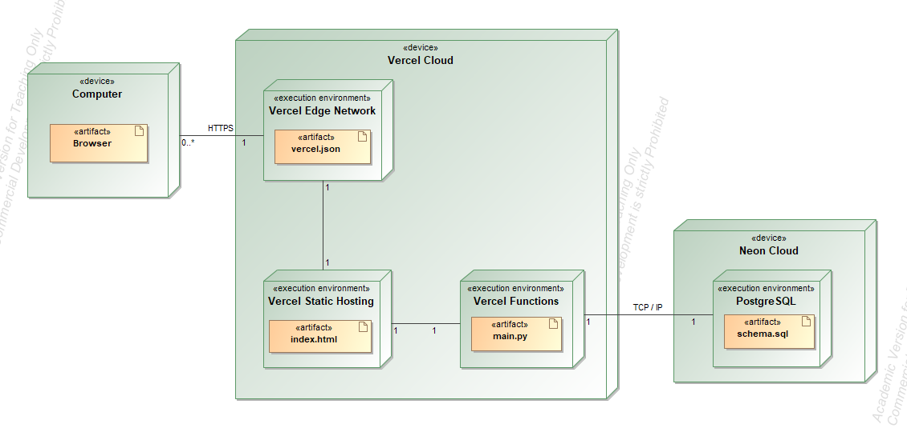

# Hoopfolio

**Krepšinio žaidėjų ir komandų skautavimo platforma**

Kauno technologijos universitetas  
Informatikos fakultetas  
Taikomosios informatikos katedra  
T120B165 Saityno taikomųjų programų projektavimas

**Darbo autorius:** Mantas Gaižutis

## 1. Sprendžiamo uždavinio aprašymas

### 1.1. Sistemos paskirtis

Projekto tikslas – palengvinti krepšinio žaidėjų ir komandų skautavimą bei padėti priimti sprendimus remiantis statistika ir skautų vertinimais.

Kuriama platforma bus skirta krepšinio klubų darbuotojams, treneriams, skautams, žaidėjams bei jų atstovams. Naudotojai galės peržiūrėti žaidėjų ir komandų profilius, jų statistiką, kurti stebėjimo sąrašus bei rengti skautavimo ataskaitas. Klubai galės stebėti potencialius komandos papildymus ir analizuoti varžovų sudėtis bei statistinius rodiklius, o žaidėjai ir jų atstovai – vertinti skirtingas komandas, jų sudėtis bei žaidimo stilių.

Pagrindiniai sistemos objektai bus stebėjimo sąrašas, stebimas objektas ir skautavimo ataskaita. Stebimas objektas – tai konkretaus žaidėjo arba komandos įtraukimas į stebėjimo sąrašą. Tas pats žaidėjas ar komanda galės būti įtraukti į kelis skirtingus sąrašus. Stebėjimo sąrašuose bus kaupiami dominantys žaidėjai arba komandos. Kiekvienas į sąrašą įtrauktas objektas turės savo stebėjimo būseną ir prioritetą, kuriuos galės nustatyti sąrašo autorius, o prie jo bus galima pridėti ir peržiūrėti skirtingų naudotojų ataskaitas su pastebėjimais, vertinimais ir išvadomis. Naudotojai galės suteikti kitiems prieigą prie savo sąrašų ir juose esančių ataskaitų bei kartu stebėti žaidėjus ar komandas. Kiekvienam stebėjimo sąrašui bus galima nurodyti jo tikslą ar poreikį (pvz. konkrečią poziciją, kurią norima papildyti, ar sezoną, kuriam ieškoma sprendimo), o tai leis analitikui palyginti sąraše esančius stebimus objektus pagal skautų vertinimus bei kitus rodiklius ir priimti tinkamą sprendimą.

### 1.2. Funkciniai reikalavimai

Sistemoje numatytos trys registruotų naudotojų rolės: skaitytojas, analitikas ir administratorius.

**Neregistruotas naudotojas galės:**

1. Peržiūrėti žaidėjų ir komandų sąrašus, atlikti paiešką ir filtruoti rezultatus.
2. Peržiūrėti žaidėjų ir komandų profilius, komandų sudėtis bei bendrus statistinius rodiklius.
3. Palyginti pasirinktų žaidėjų arba komandų statistinius rodiklius.
4. Užsiregistruoti ir prisijungti prie sistemos.

**Skaitytojas papildomai galės:**

1. Peržiūrėti jam bendrinamus stebėjimo sąrašus ir jų informaciją.
2. Peržiūrėti sąrašų stebimus objektus ir jų skautavimo ataskaitas.
3. Peržiūrėti stebimo objekto skautų įvertinimų suvestinę.
4. Palyginti sąraše esančius stebimus objektus tarpusavyje pagal jų skautų vertinimus.
5. Atsijungti nuo sistemos.

**Analitikas galės naudotis skaitytojo funkcijomis ir papildomai:**

1. Kurti, peržiūrėti, redaguoti ir trinti savo stebėjimo sąrašus, nurodant jų tikslą (pvz. ieškomą poziciją ar sezoną).
2. Bendrinti sąrašus su kitais naudotojais ir valdyti jų prieigos teises.
3. Įtraukti žaidėjus arba komandas į sąrašus, peržiūrėti stebimus objektus, keisti jų būseną, prioritetą ir stebėjimo kontekstą bei pašalinti juos iš sąrašo.
4. Kurti, peržiūrėti, redaguoti ir trinti savo skautavimo ataskaitas. Ataskaitoje nurodyti stebėjimo datą, stiprybes, silpnybes, įžvalgas, išvadas ir prireikus statistinius argumentus.
5. Ataskaitose skirti balus pagal nustatytus žaidėjų arba komandų vertinimo kriterijus.
6. Filtruoti stebėjimo sąrašus, stebimus objektus ir ataskaitas.

**Administratorius galės naudotis analitiko funkcijomis ir papildomai:**

1. Pridėti ir taisyti žaidėjų bei komandų profilius ir komandų sudėtis.
2. Įvesti ir atnaujinti bendrus žaidėjų bei komandų statistinius rodiklius.
3. Peržiūrėti naudotojų sąrašą ir keisti jų roles.

## 2. Sistemos architektūra

Sistemos sudedamosios dalys:

- Kliento pusė (angl. Front-End) – React ir TypeScript, o kūrimui ir programos surinkimui bus naudojamas Vite;
- Serverio pusė (angl. Back-End) – Python ir FastAPI;
- Duomenų bazė – PostgreSQL.

Kliento pusė bus skirta naudotojo sąsajai, o serverio pusė – sistemos veikimo logikai, duomenų tvarkymui, autentifikacijai ir prieigos teisių tikrinimui. Duomenų bazės užklausoms bus naudojama SQLAlchemy ORM biblioteka.

Sistemos kliento ir serverio dalys bus talpinamos Vercel platformoje. Kliento dalies statiniai failai bus pateikiami naudojant Vercel infrastruktūrą, o FastAPI serverio dalis bus vykdoma naudojant Vercel Functions. PostgreSQL duomenų bazė bus talpinama Neon platformoje. Naudotojai aplikaciją pasieks per savo pasirinktą interneto naršyklę, o kliento dalis per HTTPS protokolą kreipsis į REST API. Serverio dalis su PostgreSQL duomenų baze bendraus PostgreSQL protokolu per TCP/IP ryšį.



*1 pav. Numatoma sistemos diegimo diagrama.*
## 3. Pirmasis laboratorinis darbas – REST API

### 3.1. Realizacija

Įgyvendintas REST API su trimis esybėmis, susietomis dviem 1:N ryšiais:

- `Watchlist` – stebėjimo sąrašas;
- `WatchlistEntry` – stebimas žaidėjas arba komanda;
- `ScoutingReport` – skautavimo ataskaita.

Kiekvienai esybei realizuotos LIST, GET, POST, PUT ir DELETE operacijos. Sąrašų gavimas palaiko puslapiavimą ir filtravimą, atsakymuose pateikiamos HATEOAS (`_links`) nuorodos. `GET /dashboard` grąžina bendrą skautavimo duomenų suvestinę.

### 3.2. Pradinis paruošimas

Reikia Python ir PostgreSQL. Komandos skirtos **Windows PowerShell** terminalui projekto aplanke.

Sukurti virtualiąją aplinką ir įdiegti priklausomybes:

```powershell
python -m venv .venv
.\.venv\Scripts\Activate.ps1
python -m pip install -r requirements.txt
```

PostgreSQL serveryje sukurti duomenų bazę `hoopfolio`. Projekto aplanke sukurti `.env` failą:

```dotenv
DB_USER=postgres
DB_PASSWORD="JUSU_SLAPTAZODIS"
DB_HOST=localhost
DB_PORT=5432
DB_NAME=hoopfolio
JWT_SECRET=IRASYKITE_SUGENERUOTA_SLAPTA_RAKTA
```

Jeigu naudojama senoji L1 demonstracinė duomenų bazė, ją galima perkurti nuo nulio (visi ankstesni projekto duomenys bus ištrinti):

```powershell
python -c "from database import engine; from models import Base; Base.metadata.drop_all(bind=engine)"
```

Sukurti lenteles pagal dabartinius modelius ir įkelti demonstracinius duomenis:

```powershell
python -c "from database import engine; from models import Base; Base.metadata.create_all(bind=engine)"
python seed.py
```

### 3.3. Pakartotinis paleidimas

Kai aplinka jau paruošta ir PostgreSQL serveris veikia:

```powershell
.\.venv\Scripts\Activate.ps1
python -m uvicorn main:app --reload
```

### 3.4. Dokumentacija ir testavimas

- Swagger UI: http://127.0.0.1:8000/docs
- OpenAPI: http://127.0.0.1:8000/openapi.json
- Postman: `postman/Hoopfolio_L1_Postman_Kolekcija.json` – L1 testų kolekcija; L2 versijoje apsaugotiems metodams reikalingas JWT.

## 4. Antrasis laboratorinis darbas – autentifikacija ir autorizacija

Įgyvendinta JWT autentifikacija ir prieigos kontrolė pagal naudotojo rolę bei objekto savininko ID. Slaptažodžiai saugomi naudojant **Argon2** maišą.

### 4.1. Autentifikacija

| Metodas | Paskirtis |
|---|---|
| `POST /auth/register` | Naudotojo registracija su `reader` role |
| `POST /auth/login` | Prisijungimas ir žetonų išdavimas |
| `POST /auth/refresh` | Žetonų atnaujinimas |
| `POST /auth/logout` | Prisijungimo atšaukimas |
| `GET /auth/me` | Prisijungusio naudotojo informacija |

- **Access token** – `HS256` algoritmu pasirašytas JWT su naudotojo ID, role ir galiojimo laiku (**15 min.**). Perduodamas `Authorization: Bearer` antraštėje.
- **Refresh token** – galioja **7 dienas**, panaudojus pakeičiamas nauju. Duomenų bazėje saugoma jo SHA-256 maiša.
- Prisijungimų būsena valdoma `login_sessions` lentelėje; atsijungus žetonai nebegalioja.

### 4.2. Prieigos teisės

| Rolė | Teisės |
|---|---|
| `reader` | Duomenų peržiūra |
| `analyst` | Savo sąrašų ir ataskaitų kūrimas bei valdymas |
| `admin` | Visų objektų ir naudotojų rolių valdymas |

Sąrašų savininkai tikrinami pagal `owner_id`, ataskaitų autoriai – pagal `author_id`. Naudotojų administravimui skirti `GET /admin/users` ir `PUT /admin/users/{user_id}/role` metodai.

### 4.3. Pradinis naudotojų paruošimas ir demonstracija

`JWT_SECRET` nustatomas `.env` faile (žr. 3.2 skyrių). Raktą galima sugeneruoti taip:

```powershell
python -c "import secrets; print(secrets.token_hex(32))"
```

Paleidus API, per [Swagger UI](http://127.0.0.1:8000/docs) (`POST /auth/register`) užregistruoti demonstracinius naudotojus, pavyzdžiui, `skautas@example.com`, `analyst@example.com` ir `reader@example.com`. Naujos paskyros gauna `reader` rolę.

Administratoriaus ir analitiko rolės priskiriamos terminale:

```powershell
python set_role.py skautas@example.com admin
python set_role.py analyst@example.com analyst
```

Per `POST /auth/login` prisijungti su pasirinkta paskyra ir gautą `access_token` įvesti Swagger **Authorize** lange. Pakeitus rolę, būtina prisijungti iš naujo.

Demonstracijai naudojami `GET /auth/me`, `GET /admin/users`, `POST /watchlists`, `POST /auth/refresh` ir `POST /auth/logout`. `reader` negali kurti sąrašų, `analyst` gali valdyti savo objektus, o `admin` – visus. Senieji `seed.py` įrašai neturi `owner_id`, todėl juos valdo administratorius; analitiko savininko teisių patikrai sukuriamas naujas sąrašas.
